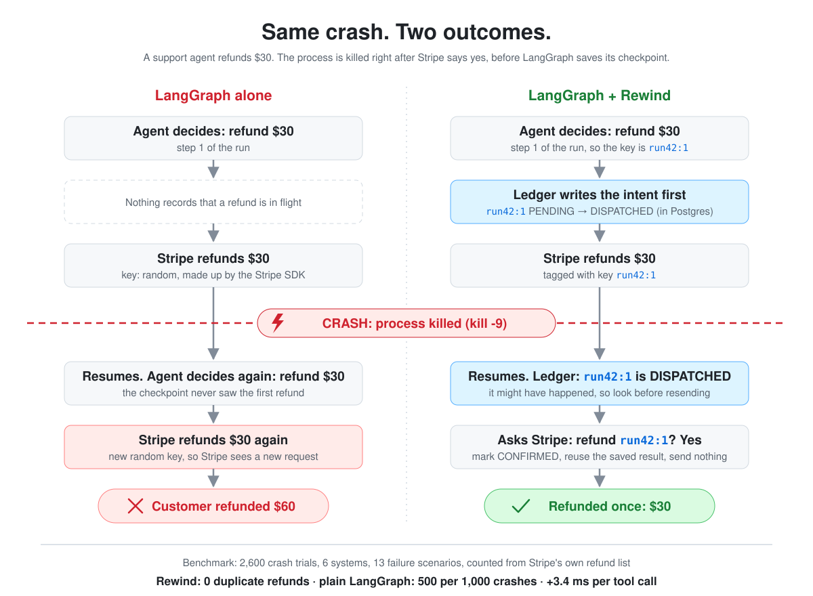

# Rewind

**Crash-safe side effects for AI agents.** Rewind is an effect ledger that sits under LangGraph. When an agent crashes, freezes or gets an ambiguous error and then resumes, every real-world action (a refund, an email) happens **exactly once**, is **safely skipped** because the world changed, or is **honestly escalated** to a human. It never happens twice by accident.

<p align="center">
  
</p>

```python
from rewind.langgraph_tools import RewindToolNode

graph.add_node("tools", RewindToolNode(registry))   # instead of LangGraph's ToolNode
```

## Why idempotency keys aren't enough

LangGraph's checkpointer saves what the agent *knew*, not what the outside world *did*. Idempotency keys alone don't fix that:

- After a resume, the LLM regenerates the call with a new tool-call id, so it sends a **new key**.
- Keys **expire** (Stripe's after 24h).
- A 500 or a timeout leaves you **unsure** whether the refund happened.
- A frozen **"zombie" worker** can wake up and act after its replacement already finished the job.

## How it works

1. **Keys come from the step, not the LLM.** The key is `run_id:step`, so a resumed agent gets the same key and the args saved before the crash.
2. **Intent → dispatch → confirm.** Each phase is committed to Postgres before the next, so a crash always leaves a row saying what *might* have happened.
3. **Look, don't guess.** After a crash, Rewind asks Stripe "is there a refund tagged `run42:1`?" instead of re-sending. If it can't tell, the effect becomes `UNKNOWN` and goes to a human.
4. **Re-check the world before resuming.** If a human refunded by hand during the downtime, the pending refund is abandoned.
5. **Fencing tokens.** A takeover bumps the run's token, so a woken zombie's writes are refused.
6. **Sagas.** Undoable effects (a charge) can be reversed newest-first by tracked compensation effects (a refund).

The full design is in [`docs/PROJECT.md`](docs/PROJECT.md).

## Results

**2,600 crash trials**, six systems, 13 failure scenarios, 20 trials each. Outcomes are counted from **Stripe's refund list and the Mailpit inbox**, never from any system's own records.

**Per 1,000 crashes** (crash points a–e plus a 25h pause):

| | LangGraph (sync / exit) | agent-ledger (sync / exit) | Temporal | DBOS | **Rewind (sync / exit)** |
|---|---|---|---|---|---|
| duplicate refunds | 500 / 667 | 167 / 408 | 167 | 167 | **0 / 0** |
| lost refunds or emails | 0 / 0 | 0 / 0 | 0 | 0 | **0 / 0** |

**By scenario** (LangGraph-based systems in `sync` mode, their strongest):

| Scenario | LangGraph | LangGraph + call-id key | agent-ledger | Temporal | DBOS | **Rewind** |
|---|---|---|---|---|---|---|
| crash before anything | ✅ | ✅ | ✅ | ✅ | ✅ | ✅ |
| crash before the HTTP call | ✅ | ✅ | ✅ | ✅ | ✅ | ✅ |
| killed mid-request | ❌ 2× refund | ✅ | ✅ | ✅ | ✅ | ✅ |
| crash after Stripe refunded | ❌ 2× refund | ✅ | ✅ | ✅ | ✅ | ✅ |
| crash between refund and email | ✅ | ✅ | ✅ | ✅ | ✅ | ✅ |
| human refunds during downtime | ❌ refunds anyway | ❌ refunds anyway | ❌ refunds anyway | ❌ refunds anyway | ❌ refunds anyway | ✅ |
| human refunds after agent did | ❌ 2× refund | ✅ | ✅ | ✅ | ✅ | ✅ |
| resume 25h later | ❌ 2× refund | ❌ 2× refund | ❌ 2× refund | ❌ 2× refund | ❌ 2× refund | ✅ |
| Stripe refunds, answers 500 | ❌ 2× refund | ❌ 2× refund | ❌ 2× refund 11/20 | ❌ 2× refund | ❌ 2× refund | ✅ |
| Stripe answers 500, no refund | ✅ | ✅ | ❌ no refund 13/20 | ✅ | ✅ | ✅ |
| Stripe refunds, client times out | ❌ 2× refund | ❌ 2× refund | ❌ 2× refund 5/20 | ❌ 2× refund | ❌ 2× refund | ✅ |
| zombie worker (before refund) | ❌ 2× refund, 2× email | ❌ 2× email | ❌ 2× email 18/20 | ✅ | ✅ | ✅ |
| zombie worker (right before email) | ❌ 2× email | ❌ 2× email | ❌ 2× email | ✅ | ❌ 2× email | ❌ 2× email |

✅ = right in 20/20 trials. Every ❌ without a count happened in 20/20.

- **Where Rewind wins:** Temporal and DBOS handle plain crashes well. Rewind's edge is when the world changed during downtime, when a pause outlives Stripe's 24h key, and on ambiguous errors (500s, timeouts).
- **Where it doesn't:** `zombie_email`. A worker that freezes after its lease check and before sending can still send once it wakes. Only the email server could close that gap.
- **Real Stripe check:** 240 trials on Stripe test mode matched the fake Stripe in 79 of 80 cells.
- **Overhead:** 3.4 ms median per tool call.

Full analysis, caveats and method: [`bench/README.md`](bench/README.md).

## Try it

```bash
docker compose up -d                       # Postgres + Mailpit
uv sync --all-groups
uv run python -m rewind.migrate
echo "STRIPE_SECRET_KEY=sk_test_..." > .env  # a Stripe TEST-mode key

uv run python scripts/run_agent.py --crash d --naive   # plain LangGraph: refunds twice
uv run python scripts/run_agent.py --crash d           # Rewind: refunds once

uv run pytest -q                           # 93 tests; the real-Stripe ones skip without a key
```

## Project layout

| Path | What |
|---|---|
| `src/rewind/ledger.py` | The effect state machine: guarded, fenced Postgres transitions |
| `src/rewind/runner.py` | `run_effect()`: one effect, at most once, with recovery |
| `src/rewind/recovery.py` | Lookup-driven recovery, backoff, escalation |
| `src/rewind/fencing.py` | Leases, fencing tokens, heartbeat |
| `src/rewind/compensation.py` | Sagas |
| `src/rewind/langgraph_tools.py` | `RewindToolNode` |
| `src/rewind/adapters/` | Stripe refund, Stripe charge, SMTP email |
| `bench/` | Fake Stripe, the six systems, crash orchestrator, reports |

## Prior work

Rewind's ledger builds directly on Brandur Leach's [Stripe-style idempotency keys in Postgres](https://brandur.org/idempotency-keys). It's close in spirit to [agent-ledger](https://github.com/rune0-dev/agent-ledger), ACRFence (arXiv 2603.20625), and durable-execution engines like [Temporal](https://temporal.io) and [DBOS](https://dbos.dev). See [`docs/PROJECT.md`](docs/PROJECT.md) §2.

## License

MIT
