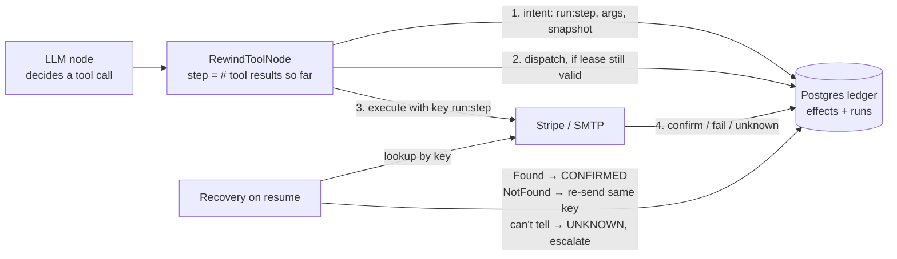

# Rewind

**Crash-safe side effects for AI agents.** Rewind is an effect ledger that sits under LangGraph. When an agent crashes, freezes or gets an ambiguous error and then resumes, every real-world action (a refund, an email) happens **exactly once**, is **safely skipped** because the world changed, or is **honestly escalated** to a human. It never happens twice by accident.

```python
from rewind.langgraph_tools import RewindToolNode

graph.add_node("tools", RewindToolNode(registry))   # instead of LangGraph's ToolNode
```

## The problem

LangGraph's checkpointer saves what the agent *knew*, not what the outside world *did*:

```
agent decides "refund $30" ─► Stripe refunds $30 ─► 💥 crash before the checkpoint
resume ─► agent decides "refund $30" again ─► Stripe refunds $30 AGAIN
```

Idempotency keys don't save you on their own. After a resume the LLM regenerates the call, with a new tool-call id and maybe different wording, so it sends a new key. Keys also expire (Stripe's after 24h), a 500 leaves you unsure whether it happened, and a frozen "zombie" worker can wake up and act after a replacement already finished the job.

## How it works



1. **Keys come from the step, not the LLM.** The key is `run_id:step`, where `step` is derived from the checkpointed conversation. A resumed agent lands on the same step, so it gets the same key and the args saved *before* the crash, whatever the LLM regenerates.
2. **Intent → dispatch → confirm.** Each phase is committed to Postgres before the next, like a pilot's checklist. A crash at any point leaves a row saying exactly what *might* have happened.
3. **Look, don't guess.** After a crash, Rewind never blindly re-sends. It asks the outside world ("is there a refund tagged `run42:1`?") using a metadata tag that outlives Stripe's 24h key retention. If the world can't answer, the effect stays `UNKNOWN` and is escalated.
4. **Re-check the world before resuming.** At intent time Rewind snapshots the relevant state (how much is already refunded). If it changed during the downtime (say, a human refunded by hand), the pending effect is abandoned rather than performed.
5. **Fencing tokens.** One worker holds a run's lease. A takeover bumps the token, so a woken zombie's writes are refused and it re-checks its lease before calling any tool.
6. **Sagas.** Compensatable effects (a charge) can be undone newest-first through tracked compensation effects (a refund), each with its own key and lifecycle.

The full design is in [`docs/PROJECT.md`](docs/PROJECT.md). Section 12.1 covers what the benchmark forced me to change.

## Results

**2,600 crash trials** across six systems and 13 failure scenarios (20 trials per cell), counted from **Stripe's refund list and the Mailpit inbox**, never from any system's own ledger. LangGraph-based systems shown with `sync` checkpoints, their strongest mode. The full table (including `exit` mode) is in [`bench/results/full-fake/summary.md`](bench/results/full-fake/summary.md), and the method in [`bench/README.md`](bench/README.md).

| Scenario | LangGraph | LangGraph + call-id key | agent-ledger | Temporal | DBOS | **Rewind** |
|---|---|---|---|---|---|---|
| crash before anything | ✅ | ✅ | ✅ | ✅ | ✅ | ✅ |
| crash before the HTTP call | ✅ | ✅ | ✅ | ✅ | ✅ | ✅ |
| killed mid-request | ❌ 2× refund | ✅ | ✅ | ✅ | ✅ | ✅ |
| crash after Stripe refunded | ❌ 2× refund | ✅ | ✅ | ✅ | ✅ | ✅ |
| crash between refund and email | ✅ | ✅ | ✅ | ✅ | ✅ | ✅ |
| human refunds during downtime | ❌ refunds anyway | ❌ refunds anyway | ❌ refunds anyway | ❌ refunds anyway | ❌ refunds anyway | ✅ |
| human refunds after agent did | ❌ 2× refund | ✅ | ✅ | ✅ | ✅ | ✅ |
| resume 25h later | ❌ 2× refund | ❌ 2× refund | ❌ 2× refund | ❌ 2× refund | ❌ 2× refund | ✅ |
| Stripe refunds, answers 500 | ❌ 2× refund | ❌ 2× refund | ❌ 2× refund 11/20 | ❌ 2× refund | ❌ 2× refund | ✅ |
| Stripe answers 500, no refund | ✅ | ✅ | ❌ no refund 13/20 | ✅ | ✅ | ✅ |
| Stripe refunds, client times out | ❌ 2× refund | ❌ 2× refund | ❌ 2× refund 5/20 | ❌ 2× refund | ❌ 2× refund | ✅ |
| zombie worker (before refund) | ❌ 2× refund, 2× email | ❌ 2× email | ❌ 2× email 18/20 | ✅ | ✅ | ✅ |
| zombie worker (right before email) | ❌ 2× email | ❌ 2× email | ❌ 2× email | ✅ | ❌ 2× email | ❌ 2× email |

✅ = right in 20/20 trials (one refund, or none when a human already refunded, and exactly one email). Every ❌ without a count happened in 20/20 trials.

**Per 1,000 crashes** (crash points a–e plus the 25h pause, 120 crashes per system):

| | LangGraph (sync / exit) | agent-ledger (sync / exit) | Temporal | DBOS | **Rewind (sync / exit)** |
|---|---|---|---|---|---|
| duplicate refunds | 500 / 667 | 167 / 408 | 167 | 167 | **0 / 0** |
| lost refunds or emails | 0 / 0 | 0 / 0 | 0 | 0 | **0 / 0** |

**Overhead:** Rewind adds **3.4 ms** median (6.4 ms p99) per tool call, 4.4 ms with fencing. That's three committed Postgres transactions against a local database ([`bench/results/overhead.json`](bench/results/overhead.json)). The Stripe adapter's precondition snapshot costs one extra Stripe read on top.

**What the numbers say, honestly:**

- **Temporal and DBOS are excellent at plain crashes.** Their stable workflow+step keys plus Stripe's idempotency make crash points a–e safe. Rewind's edge is elsewhere:
  - **The world changed while the agent was down.** No other system re-checks it before resuming.
  - **Keys outlived by a pause.** Stripe forgets a key after 24h; Rewind finds the refund by its metadata tag instead.
  - **Ambiguous errors.** On a 500 or timeout, the others hand the error to the LLM, whose retry is a *new* step with a new key. Rewind looks the refund up first.
- **Rewind fails `zombie_email`, and so do most others.** A worker that freezes *after* re-checking its lease and *before* sending can still send once it wakes. Rewind can't close that window from the client side; only the email server could, by checking fencing tokens. For refunds, Stripe's idempotency key covers the same window. **Temporal passed** because it cancels the timed-out activity's thread the moment the worker resumes.
- **agent-ledger** keys effects by a hash of the arguments. That protects it whenever the LLM repeats the *exact* same call, but it also caches failures: a retry after a 500-with-no-refund returns the cached failure (no refund in 13/20). When the LLM varies an optional argument, the key changes and the protection is gone.
- **Recovery takes longer** for systems that must wait out a dead worker: Rewind waits for the 2s lease to expire (2.2s p50), and Temporal waits for its activity and workflow-task timeouts (15s p50). All of these are tunable.
- **Caveats.** The "LLM" is a seeded scripted model, so plan-level divergence on resume isn't tested. Everything ran on one laptop. Baselines use their documented idempotency patterns but weren't individually tuned. Tools report errors back to the LLM, a common agent pattern. A Temporal or DBOS step that instead retried internally under the same key would avoid the duplicate after a 500, but would keep receiving Stripe's stored 500 for 24h: stuck, not duplicated. The bulk runs use a [fake Stripe](bench/fakestripe.py) that implements Stripe's idempotency semantics; see the real-Stripe check below.

**Checked on real Stripe test mode.** The 8 scenarios that don't need injected faults or time travel were re-run against the real Stripe API: 240 trials, 3 per cell ([`bench/results/validate-real/summary.md`](bench/results/validate-real/summary.md)). **79 of 80 cells match the fake's outcome.** The exception is agent-ledger in `exit` mode at crash point (d): 3/3 duplicates on real Stripe versus 12/20 on the fake. Its key depends on whether the regenerated call happens to repeat the same optional argument. Rewind was correct in all 42 of its real-Stripe trials outside `zombie_email` (the known gap above, 0/6 there).

## Try it

```bash
docker compose up -d                       # Postgres + Mailpit
uv sync --all-groups
uv run python -m rewind.migrate
echo "STRIPE_SECRET_KEY=sk_test_..." > .env  # a Stripe TEST-mode key

uv run python scripts/run_agent.py --crash d --naive   # plain LangGraph: refunds twice
uv run python scripts/run_agent.py --crash d           # Rewind: refunds once
uv run python scripts/run_agent.py --claude            # a real Claude model decides (ANTHROPIC_API_KEY)

uv run pytest -q                           # 93 tests; the real-Stripe ones skip without a key
```

The benchmark: see [`bench/README.md`](bench/README.md).

## Project layout

| Path | What |
|---|---|
| `src/rewind/ledger.py` | The effect state machine: guarded, fenced Postgres transitions |
| `src/rewind/runner.py` | `run_effect()`: one effect, at most once, with recovery |
| `src/rewind/recovery.py` | Lookup-driven recovery, backoff, escalation |
| `src/rewind/fencing.py` | Leases, fencing tokens, heartbeat |
| `src/rewind/compensation.py` | Sagas |
| `src/rewind/langgraph_tools.py` | `RewindToolNode` |
| `src/rewind/adapters/` | Stripe refund, Stripe charge, SMTP email |
| `bench/` | Fake Stripe, the six systems, crash orchestrator, reports |

## Prior work

Rewind's ledger builds directly on Brandur Leach's [Stripe-style idempotency keys in Postgres](https://brandur.org/idempotency-keys). It's close in spirit to [agent-ledger](https://github.com/rune0-dev/agent-ledger) and ACRFence (arXiv 2603.20625), and to durable-execution engines like [Temporal](https://temporal.io) and [DBOS](https://dbos.dev). Those are strong baselines, and the results above say where each one wins. See `docs/PROJECT.md` §2.

## License

MIT
